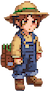
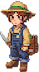
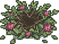
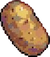

# La Odisea de Jacinta
Doña Jacinta es una chinita[^1] de la pampa bonaerense que tiene la tarea de cocinar el locro para la peña patria de su pueblo. 

## Equipo de desarrollo
- [@ValentinaMiaArenas](https://github.com/ValentinaMiaArenas)
- [@SofiaPK](https://github.com/SofiaPK)
- [@julietatonini](https://github.com/julietatonini)

## Capturas
#### Nivel 1

#### Nivel 2

#### Nivel 3

## Reglas de Juego / Instrucciones
### Teclas:
- flecha ↑: mover hacía arriba.
- flecha ↓: mover hacía abajo.
- flecha ←: mover hacía la izquierda.
- flecha →: mover hacía la derecha.

- b: buscar ingrediente en el pastizal.
- t: toma mate.
- r: recargar mate.
- f: usar facón (defenderse).

## Primer nivel:
Jacinta tiene que recorrer el campo buscando los ingredientes necesarios para cocinar el locro. Sin embargo, debe tener cuidado: una yarará se encuentra entre los pastizales.

### Objetos con los que el personaje interactúa o colisiona:
- Pastizal: surgen tres situaciones random:
    - El pastizal contiene alguno de los tres ingredientes recolectables necesarios para el locro, lo cual hace que se sumen al inventario.
    - El pastizal está vacío.
    - En el pastizal está escondida una yarará.

    
    
    
    

    
    
    
    

- Yarará[^2] (enemiga): se camufla entre los pastizales, es venenosa por lo que al interactuar con Jacinta le resta vida y la empuja un casillero hacia atrás.

    

## Segundo nivel:
Jacinta tiene que vencer al lobizón y esquivar al pampero para llegar al pueblo.

### Objetos con los que el personaje interactúa o colisiona:
- Lobizón[^3] (enemigo): al colisionar con Jacinta le resta vida. Esta situación requiere un método de defensa: jacinta  usa un facón para ello.

    
    
    
- Pampero[^4] (obstáculo): al colisionar con Jacinta hace que se maree y se inviertan temporalmente los controles de movimiento (la tecla de arriba va hacia abajo y viceversa, la tecla izquierda va hacia derecha y viceversa).

    

## Tercer nivel:
Jacinta tiene que atravesar la pista de baile esquivando los proyectiles que le lanzan las parejas que bailan chacarera. Puede usar el facón para defenderse. Ella tiene que llegar hasta la cocina. Si consigue llegar sin morir, gana.

### Objetos con los que el personaje interactúa o colisiona:
- Parejas de baile (enemigas): se mueven en patrones fijos.

    
    

    - Proyectiles: puede ser de tipo sombrero, pañuelo o alpargata. Si colisionan con Jacinta, muere.

        
        
        

## Otros
- Programación con Objetos I - Universidad Nacional de Quilmes
- Versión de wollok: 4.3.0
- Una vez terminado, no tenemos problemas en que el repositorio sea público.

## Notas

[^1]: china, o en menor medida, guaina, se le llama a la esposa del gaucho, figura central y a menudo silenciada de la vida rural rioplatense.

[^2]: la yarará es una especie de serpiente endémica de Argentina.

[^3]: figura mítica del folklore argentino, vaga por los campos y cementerios, asustando a los perros y alimentándose de carroña.

[^4]: el pampero es una ráfaga de viento helado.